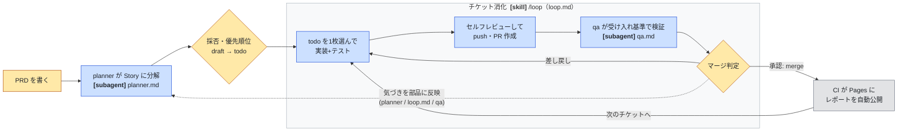

# 実践編: 概要

## 1. 実践編とは

本編（Step 0〜4）で、あなたはループの構成要素——検証ループ・外部状態・検証の分離・
自動化——を一つずつ手に入れました。実践編では、それらの部品を実務の開発フロー
（要件→チケット→PR→マージ→デプロイ）に写像します。舞台は同じ kakeibo ですが、
今回は PdM（要件を書く）・Eng（実装する）・QA（検証する）の3つの帽子を、
あなた一人でかぶり替えながら進めます。

**あなたはプロダクトのコードを1行も書きません。あなたが作るのはループの部品だけで、
プロダクトはすべてループが作ります。**

具体的には、あなたが書くのは PRD・エージェント定義・ループのプロンプトです。
チケットの起票・実装・PR・デプロイは、すべてループ（エージェント）が行います。
あなたの仕事は、入口で要件と優先順位を決め、出口でマージを判定し、
気づきをループの部品にフィードバックすることです。

## 2. 地図: 誰が・何を・どのように作るか

作り手は3者います。**教材**（fork した時点で存在）、**学習者=人間**
（ループの部品を作る）、**ループ=エージェント**（プロダクトを作る）です。

| 成果物 | 誰が作る | どのように |
|--------|---------|-----------|
| 手順書・PRD テンプレ・tickets/ スキーマ・CI ワークフロー・PR テンプレ | 教材（同梱） | fork で入手。読んで理解する対象 |
| PRD「月次レポート機能」 | 学習者（PdM） | テンプレートに記入（Phase 1） |
| planner エージェント定義 | 学習者（PdM） | 「良いチケットの4条件」チェックリストに沿って自作（Phase 1） |
| チケット群 `tickets/*.md` | チケット作成ループ | planner が PRD から分解・起票。学習者は採否・優先順位の判定のみ |
| 消化ループのプロンプト(`.claude/loop.md`) | 学習者（Eng） | 構成要素（取得→ブランチ→実装→検証→autoreview→PR）から組み立て（Phase 2） |
| qa エージェント定義 | 学習者（QA） | 受け入れ基準ベースの検証手順を記述（Phase 2） |
| `report` コマンドの実装・テスト・PR | 消化ループ | 1チケット=1ブランチ=1PR で周回。学習者はマージ判定のみ |
| 公開される月次レポート | CI | merge を契機に自動デプロイ |
| レビュー観点の蓄積（qa・loop.md への追記） | 学習者+Claude | マージ判定のたびに気づきを部品へ反映（下記フィードバックループ） |
| ループの改善（規約追加・skill 化） | 学習者 | Phase 3 で失敗を1つ選びシステムに埋め込む |

全体の流れを図にすると次のようになります（GitHub 上でそのまま描画されます）。

実線が仕事の流れ、点線があなたの気づきが還流するフィードバックループです。
色は作り手を表します（黄=人間の判断、青=ループ、灰=CI）。
`[skill]` は `/loop`（`.claude/loop.md`）、`[subagent]` は `.claude/agents/` のエージェント定義が
動く箇所です。左の「PRD〜採否」が Phase 1、囲みの「チケット消化」が Phase 2、
右端の CI が Phase 3 に対応します。

## 3. 前提

- 本編（Step 0〜4）を完走していること
- Node.js 20 以上
- gh CLI がインストール・認証済みであること(`gh auth status` が通ること)
- GitHub アカウント

## 4. セットアップ

1. このリポジトリを **fork** し、fork した方を clone してください。実践編は
   PR・CI・Pages を実際に使うため fork が必須です。本編と違い、**push は自分の
   fork に対して行います**。
2. `cd app && npm install` で依存関係をインストールします。
3. **ウォームアップ**: このリポジトリの main には本編用に仕込まれた欠陥が
   まだ残っています。本編 Step 1 と同じ要領で、Claude に
   「`npm test` / `npm run lint` / `npm run typecheck` がすべて通るまで修正して」
   と依頼し、検証ループを回してグリーンな main を作り、fork に push してください。
   これが実践編に入る前の卒業試験です。詰まったら本編の
   [docs/basic/answers.md](../basic/answers.md)（答え合わせ）を参照してください。
4. GitHub 上の fork リポジトリで **Settings → Pages → Source を「GitHub Actions」に変更**します。
5. Actions タブでワークフローの実行が許可されていることを確認します。

## 5. 進め方

実践編は3つの Phase で構成されます。この順番で進めてください。

1. [Phase 1: チケット作成ループ](phase1-planning-loop.md) — PRD を書き、planner にチケットを起票させる
2. [Phase 2: 消化ループ](phase2-delivery-loop.md) — 1チケット=1PR で実装ループを回す
3. [Phase 3: 出口とループ改善](phase3-release.md) — マージ・デプロイ・気づきのフィードバック

## 6. 付録: 実践編で使うファイル

| ファイル | 内容 |
|---------|------|
| [tickets/README.md](../../tickets/README.md) | チケット（JIRA 風モック）の frontmatter 仕様とファイル命名規則 |
| [.github/workflows/ci.yml](../../.github/workflows/ci.yml) | PR 向け CI。test / lint / typecheck を実行する |
| [.github/workflows/deploy-report.yml](../../.github/workflows/deploy-report.yml) | main への push を契機にレポートを GitHub Pages へ自動公開する |
| [.github/pull_request_template.md](../../.github/pull_request_template.md) | PR に必須の4点セット（意図・動作証明・リスク・レビュー観点）のテンプレート |
| [docs/practical/prd-template.md](prd-template.md) | Phase 1 で使う PRD 記入テンプレート |
| [docs/practical/answers.md](answers.md) | 実践編の模範解答集（詰まったときのみ参照） |

さあ、[Phase 1](phase1-planning-loop.md) から始めてください。
