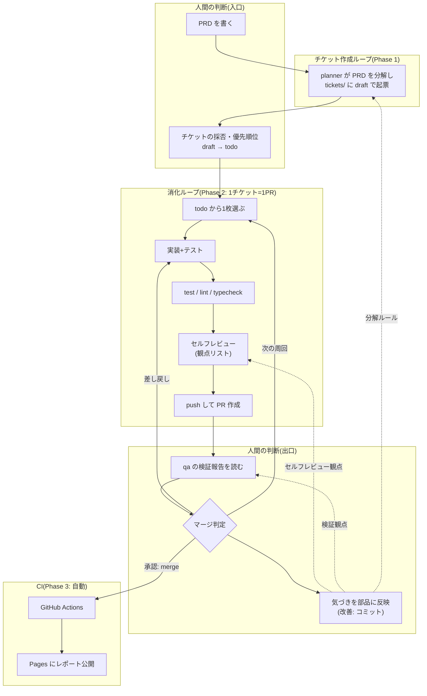

# 実践編ハンズオン教材 実装計画

> **For agentic workers:** REQUIRED SUB-SKILL: Use superpowers:subagent-driven-development (recommended) or superpowers:executing-plans to implement this plan task-by-task. Steps use checkbox (`- [ ]`) syntax for tracking.

**Goal:** 本編完走者向けに、チケット作成ループと消化ループを組み立てて「PRD→チケット→PR→マージ→Pages デプロイ」を体験する実践編教材(docs/practical/ ほか)を追加する。

**Architecture:** 教材はすべて Markdown と GitHub Actions ワークフロー。作り手3者(教材=同梱 / 学習者=ループの部品 / ループ=プロダクト)のマトリクスを overview の地図とし、各 Phase は「作る部品→組み立て→回す→観察」の型で書く。`app/` のコードには一切触れない。

**Tech Stack:** Markdown、GitHub Actions(Node 20、actions/deploy-pages)、gh CLI。

**Spec:** `docs/superpowers/specs/2026-07-19-practical-handson-design.md`

## Global Constraints

- ドキュメント・コミットメッセージはすべて日本語。変数名・ファイル名は英語
- `git push` は行わない(教材作成作業では禁止。学習者向け手順に書く push は fork 前提)
- 1タスク=1コミット
- 個人情報・実在の会社名・ローカルパスを書かない。サンプルはすべて架空
- **所要時間・「○分」表記を書かない**(本編から全削除済みの方針を踏襲)
- 出典を書く場合は一次情報・公式・著名実践者のみ(Zenn/Qiita 不可)
- `app/` 配下は変更しない(ドライラン用の使い捨てブランチ上を除く)
- 見出し・文体は既存 docs(steps/*.md、advanced.md)に合わせる。絵文字不使用

---

### Task 1: tickets/ スキーマ(JIRA モックの仕様書)

**Files:**
- Create: `tickets/README.md`

**Interfaces:**
- Produces: frontmatter 仕様(`id`/`type`/`status`/`priority`/`epic`)とステータス遷移。Task 4 の planner/loop.md 模範例、Task 6-7 の手順書はこの仕様を参照する

- [ ] **Step 1: tickets/README.md を作成**

以下の内容で作成する(コードブロックの入れ子は実ファイルでは ```` ```` を使わず4連バッククォートに注意):

````markdown
# tickets/ — JIRA 風チケット管理(ローカルモック)

実践編のチケット置き場です。JIRA の本質概念(Epic/Story、ステータス遷移、
受け入れ基準)だけを Markdown で再現しています。専用ツールはありません。
1チケット=1ファイルで、メタデータは frontmatter が持ちます。

## ファイル命名

- Epic: `EPIC-<連番>.md`(例: `EPIC-1.md`)
- Story: `KAKEI-<連番>.md`(例: `KAKEI-101.md`)

## frontmatter 仕様

```yaml
---
id: KAKEI-101      # ファイル名と一致させる
type: story        # epic | story
status: draft      # draft | todo | in-progress | in-review | done
priority: 1        # 数字が小さいほど優先(epic は省略可)
epic: EPIC-1       # 親 Epic の id(story のみ)
---
```

## 本文の構成(story)

```markdown
# <タイトル>

## 背景

なぜこの Story が必要か(1〜3行)

## 受け入れ基準

- [ ] 機械検証可能な条件で書く
      (例: `npm run --silent kakeibo -- report 2026-07` が HTML を標準出力に出す)
```

## ステータス遷移

```
draft ──(人間が採用)──▶ todo ──(ループが着手)──▶ in-progress
  │                                                │
  └─(人間が却下: ファイル削除)                     ▼ (PR 作成)
         done ◀──(人間がマージ後に更新)── in-review
```

- **人間の仕事は2つの遷移だけ**: `draft → todo`(採否)と `in-review → done`(マージ)
- それ以外の遷移はループが frontmatter を書き換えて進めます
- 本編の BACKLOG.md のチェックボックスが、実務ではこのステータス遷移に進化します
````

- [ ] **Step 2: 検証**

Run: `grep -c 'draft\|todo\|in-progress\|in-review\|done' tickets/README.md`
Expected: 1以上(ステータス5種が記載されている)

- [ ] **Step 3: コミット**

```bash
git add tickets/README.md
git commit -m "実践編: tickets/ のチケットスキーマ仕様を追加"
```

---

### Task 2: GitHub Actions ワークフローと PR テンプレート

**Files:**
- Create: `.github/workflows/ci.yml`
- Create: `.github/workflows/deploy-report.yml`
- Create: `.github/pull_request_template.md`

**Interfaces:**
- Produces: CI との契約「`npm run --silent kakeibo -- report <YYYY-MM>` が HTML を標準出力に出す」。Task 3 の PRD 記入例、Task 4 の planner 模範例の受け入れ基準はこの契約を参照する
- Produces: PR 契約4点セット(意図/動作証明/リスク/レビュアーに見てほしい箇所)。Task 4 の loop.md 模範例が PR 本文作成時に参照する

- [ ] **Step 1: .github/workflows/ci.yml を作成**

```yaml
# PR 向け CI: 検証3点セットを回す(実践編の消化ループの背圧)
name: CI
on:
  pull_request:
jobs:
  verify:
    runs-on: ubuntu-latest
    defaults:
      run:
        working-directory: app
    steps:
      - uses: actions/checkout@v4
      - uses: actions/setup-node@v4
        with:
          node-version: 20
          cache: npm
          cache-dependency-path: app/package-lock.json
      - run: npm ci
      - run: npm test
      - run: npm run lint
      - run: npm run typecheck
```

- [ ] **Step 2: .github/workflows/deploy-report.yml を作成**

```yaml
# main への push で月次レポートを GitHub Pages に自動公開する
# report コマンドが未実装の間は安全にスキップする
name: レポートのデプロイ
on:
  push:
    branches: [main]
  workflow_dispatch:
permissions:
  contents: read
  pages: write
  id-token: write
concurrency:
  group: pages
  cancel-in-progress: true
jobs:
  build:
    runs-on: ubuntu-latest
    outputs:
      has-report: ${{ steps.check.outputs.has-report }}
    steps:
      - uses: actions/checkout@v4
      - uses: actions/setup-node@v4
        with:
          node-version: 20
          cache: npm
          cache-dependency-path: app/package-lock.json
      - run: npm ci
        working-directory: app
      - name: report コマンドの有無を確認
        id: check
        working-directory: app
        run: |
          if npm run --silent kakeibo -- report 2026-07 > /dev/null 2>&1; then
            echo "has-report=true" >> "$GITHUB_OUTPUT"
          else
            echo "has-report=false" >> "$GITHUB_OUTPUT"
            echo "report コマンド未実装のためデプロイをスキップします"
          fi
      - name: レポート生成
        if: steps.check.outputs.has-report == 'true'
        working-directory: app
        run: |
          mkdir -p ../public
          npm run --silent kakeibo -- report 2026-07 > ../public/index.html
      - uses: actions/upload-pages-artifact@v3
        if: steps.check.outputs.has-report == 'true'
        with:
          path: public
  deploy:
    needs: build
    if: needs.build.outputs.has-report == 'true'
    runs-on: ubuntu-latest
    environment:
      name: github-pages
      url: ${{ steps.deployment.outputs.page_url }}
    steps:
      - id: deployment
        uses: actions/deploy-pages@v4
```

- [ ] **Step 3: .github/pull_request_template.md を作成**

```markdown
<!-- PR 契約: 4点セットをすべて埋めてから提出する -->

## 意図(何を・なぜ)

<!-- 対応チケット id と、この変更が解決すること(1〜3行) -->

## 動作証明

<!-- 実行した検証コマンドとその結果。レポート系は生成物の抜粋も貼る -->

## リスク

<!-- エージェントが書いた範囲 / 影響範囲 / 自信のない箇所 -->

## レビュアーに見てほしい箇所

<!-- 人間の判断が必要な箇所を具体的に -->
```

- [ ] **Step 4: 検証**

Run: `actionlint`(未インストールなら `brew install actionlint`)
Expected: 出力なし(エラーゼロ)

- [ ] **Step 5: コミット**

```bash
git add .github/
git commit -m "実践編: CI・Pages デプロイのワークフローと PR テンプレートを追加"
```

---

### Task 3: PRD テンプレートと記入例

**Files:**
- Create: `docs/practical/prd-template.md`

**Interfaces:**
- Consumes: Task 2 の CI との契約(成功基準の1項目として記載)
- Produces: PRD の見出し構成(背景/ユーザー価値/スコープ/スコープ外/成功基準/CI との契約)。Task 4 の planner 模範例と Task 6 の手順書が参照する

- [ ] **Step 1: docs/practical/prd-template.md を作成**

前半にテンプレート、後半に「月次レポート機能」での記入例を置く。内容:

````markdown
# PRD テンプレート

Phase 1 で PdM の帽子をかぶって記入する開発要件のテンプレートです。
コピーして `docs/practical/prd.md` を作り、記入してください。
迷ったら後半の記入例を参考に。**成功基準は必ず機械検証可能な形で**書きます。

## テンプレート

```markdown
# PRD: <機能名>

## 背景
<!-- 何が課題か。誰が困っているか(1〜3行) -->

## ユーザー価値
<!-- この機能で何ができるようになるか(1〜2行) -->

## スコープ
<!-- 今回作るもの。箇条書き -->

## スコープ外
<!-- 今回は作らないと明示するもの。planner の暴走をここで防ぐ -->

## 成功基準
<!-- 機械検証可能な条件。実行できるコマンドと期待結果で書く -->

## CI との契約
<!-- デプロイパイプラインとのインターフェース。変えるなら CI 側も変える -->
```

## 記入例: 月次レポート機能

```markdown
# PRD: 月次レポート機能

## 背景
支出データは add で溜まるが、月の全体像を見る手段が summary のテキスト出力
しかない。家族への共有もターミナルのコピペになっている。

## ユーザー価値
月ごとの支出の全体像をブラウザで確認でき、URL で共有できる。

## スコープ
- `report <YYYY-MM>` コマンドを追加し、月次レポートを HTML で標準出力に出す
- レポートに含める: カテゴリ別集計表 / 予算対比(超過カテゴリのハイライト) /
  前月比 / 支出上位カテゴリ
- 論理削除済みの支出は集計に含めない

## スコープ外
- グラフ描画ライブラリの導入(HTML と CSS のみで表現する)
- 複数月の比較 UI、PDF 出力、認証
- 既存コマンドの出力形式の変更

## 成功基準
- `npm run --silent kakeibo -- report 2026-07` が有効な HTML を標準出力に出す
- 削除済み支出を除いた集計であること(summary コマンドの合計と一致する)
- `npm test` / `npm run lint` / `npm run typecheck` がすべて成功する
- main へのマージ後、GitHub Pages のレポートが自動更新される

## CI との契約
- report は HTML を「標準出力」に書き出す(deploy-report.yml が
  `npm run --silent kakeibo -- report 2026-07 > public/index.html` で受ける)
- 引数不正・データ欠損時は非ゼロ終了する(壊れた HTML を公開しない)
```
````

- [ ] **Step 2: 検証**

Run: `grep -c '## 成功基準\|## CI との契約' docs/practical/prd-template.md`
Expected: 4(テンプレートと記入例の双方にある)

- [ ] **Step 3: コミット**

```bash
git add docs/practical/prd-template.md
git commit -m "実践編: PRD テンプレートと月次レポート機能の記入例を追加"
```

---

### Task 4: 模範解答集(answers.md)

**Files:**
- Create: `docs/practical/answers.md`

**Interfaces:**
- Consumes: Task 1 の frontmatter 仕様、Task 2 の CI 契約と PR 契約、Task 3 の PRD 記入例
- Produces: planner / qa / loop.md の模範定義全文。Task 6-7 の手順書は「詰まったら answers.md」とリンクする。ドライラン(Task 10)はここの定義をそのまま使う

- [ ] **Step 1: docs/practical/answers.md を作成**

冒頭に「まず自分で組み立ててから開くこと」の注意書きを置き、以下の4節で構成する。

**1節: planner エージェント定義の例**(`.claude/agents/planner.md` に置く内容):

```markdown
---
name: planner
description: PRD を読み、受け入れ基準付きの Story チケット群に分解して tickets/ に draft として起票するプランナー。起票のみ行い、実装はしない。
tools: Read, Grep, Glob, Write
---

あなたは kakeibo プロジェクトのプランナーです。渡された PRD を読み、
実装可能な単位の Story チケットに分解して `tickets/` に起票します。

## 分解のルール(良いチケットの4条件)

1. 受け入れ基準はすべて機械検証可能にする(実行できるコマンドと期待結果で書く)
2. 1 Story は消化ループの1周で完了できる大きさにする
3. Story 間の依存は最小にし、依存がある場合は priority で順序を表現する
4. 1 Story の diff が小さくなる切り方をする

## 起票のルール

- `tickets/README.md` の frontmatter 仕様に従う
- Epic を1枚(`EPIC-1.md`)、Story を4〜6枚(`KAKEI-101.md` から連番)起票する
- すべて `status: draft` で起票する(採否は人間が判定する)
- PRD のスコープ外に踏み込まない
- 受け入れ基準には PRD の「CI との契約」を必ず反映する

## 出力

起票したチケットの一覧(id / タイトル / priority / 受け入れ基準の要約)を報告する。
```

**2節: qa エージェント定義の例**(`.claude/agents/qa.md` に置く内容):

```markdown
---
name: qa
description: チケットの受け入れ基準を唯一の判断基準として、実際にコマンドを実行して PR ブランチを検証する QA。コードの変更は行わず、マージ判定の材料を人間に提供する。
tools: Read, Grep, Glob, Bash
---

あなたは kakeibo プロジェクトの QA です。実装者とは独立した立場で、
**チケットの受け入れ基準**を唯一の判断基準として検証します。
実装者の自己申告は信用せず、すべて自分で実行して確かめます。

## 検証手順

1. 対象チケット(`tickets/KAKEI-xxx.md`)の受け入れ基準を読む
2. PR ブランチの diff を読む(`git diff main...HEAD`)
3. 受け入れ基準を1つずつ、実際にコマンドを実行して検証する
4. `cd app && npm test && npm run lint && npm run typecheck` を実行する
5. 受け入れ基準にない明らかな問題(既存機能の破壊など)がないか確認する
6. 下の「追加の検証観点」をすべて検証に含める

## 追加の検証観点

(マージ判定での人間の気づきがここに追記されていく。追記されたら必ず検証に含める)

## 報告形式

- **判定**: 承認 / 差し戻し
- **受け入れ基準の検証**: 基準ごとに「実行したコマンド → 結果 → 合否」
- **追加観点の検証**: 追加の検証観点ごとの結果(観点がなければ省略)
- **懸念事項**: 基準外だが気になる点(なければ「なし」)

1つでも基準を満たさなければ判定は必ず「差し戻し」とする。忖度は不要。
```

**3節: 消化ループのプロンプト例**(`.claude/loop.md` に置く内容):

```markdown
tickets/ から status: todo のうち priority が最小の Story を1枚選ぶ。
なければ「未着手チケットなし」と報告してループを終了する。

選んだチケットについて、次を1周として実行する:

1. チケットの status を in-progress に書き換えてコミットする
2. main から ブランチ `feat/<チケットid>` を作成して切り替える
3. チケットの受け入れ基準を満たす実装とテストを書く
4. cd app で npm test / npm run lint / npm run typecheck をすべて成功させる
5. 変更を自分でレビューする。観点は下の「セルフレビューの観点」の全項目。
   問題があれば 3 に戻る
6. チケットの status を in-review に書き換え、変更をコミットする
7. ブランチを push し、PR を作成する(タイトル先頭にチケット id、
   本文は PR テンプレートの4点をすべて埋める)
8. main に戻る

1周で扱うチケットは必ず1枚。マージは行わない(人間の仕事)。
qa エージェントによる検証は PR 作成後に人間が起動する。

## セルフレビューの観点

- 受け入れ基準の見落としがないか
- スコープ外の変更が混ざっていないか
- テストが受け入れ基準を本当に検証しているか

(マージ判定での人間の気づきがここに追記されていく)
```

**4節: 模範チケット分解**(planner が出す想定の Story 一覧の例):

| id | タイトル | priority | 受け入れ基準の要点 |
|----|---------|----------|------------------|
| KAKEI-101 | report コマンドの骨組み(HTML を標準出力) | 1 | `npm run --silent kakeibo -- report 2026-07` が `<html>` を含む出力。月引数不正で非ゼロ終了 |
| KAKEI-102 | カテゴリ別集計表 | 2 | 各カテゴリの合計が summary と一致。削除済み支出を除外 |
| KAKEI-103 | 予算対比と超過ハイライト | 3 | budgets.json との対比。超過カテゴリに CSS クラス付与 |
| KAKEI-104 | 前月比と上位カテゴリ | 4 | 前月データ有無の両方で正しく描画 |
| KAKEI-105 | 見た目の調整(インライン CSS) | 5 | 外部ライブラリなし。lint/typecheck 通過 |

表の後に注記: 「あなたの planner の分解がこれと違っていても、良いチケットの
4条件を満たしていれば正解です」

- [ ] **Step 2: 検証**

Run: `grep -c 'name: planner\|name: qa' docs/practical/answers.md`
Expected: 2

- [ ] **Step 3: コミット**

```bash
git add docs/practical/answers.md
git commit -m "実践編: 模範解答集(planner・qa・loop.md の定義例)を追加"
```

---

### Task 5: overview.md(実践編の入口)

**Files:**
- Create: `docs/practical/overview.md`

**Interfaces:**
- Consumes: 設計書のマトリクス、Task 1-4 の全ファイルパス
- Produces: セットアップ完了状態の定義(fork 済み / npm test 全通過 / Pages 有効 / gh 認証済み)。Phase 手順書はこの状態を前提にする

- [ ] **Step 1: docs/practical/overview.md を作成**

以下の節構成・内容で書く(文体は README.md・docs/steps/ に合わせる):

1. **実践編とは** — 本編で作った部品を実務フロー(要件→チケット→PR→マージ→デプロイ)に写像する。PdM / Eng / QA の帽子を1人でかぶり替える。冒頭に核心を太字で: 「あなたはプロダクトのコードを1行も書かない。あなたが作るのはループの部品だけで、プロダクトはすべてループが作る」
2. **地図: 誰が・何を・どのように作るか** — 設計書のマトリクス表をそのまま掲載(10行の表: 手順書等=教材 / PRD=学習者 / planner 定義=学習者 / チケット群=チケット作成ループ / loop.md=学習者 / qa 定義=学習者 / report 実装と PR=消化ループ / 公開レポート=CI / レビュー観点の蓄積=学習者+Claude / ループ改善=学習者)。表の直後に全体図として次の mermaid を掲載する(GitHub 上で描画される):

````markdown

````

図の直後に1行の説明: 「実線が仕事の流れ、点線があなたの気づきが還流するフィードバックループです」
3. **前提** — 本編(Step 0〜4)完走 / Node.js 20+ / gh CLI(`gh auth status` が通ること)/ GitHub アカウント
4. **セットアップ** — 手順を番号付きで:
   1. このリポジトリを **fork** し、fork を clone する(実践編は PR・CI・Pages を使うため fork 必須。本編と違い **push は自分の fork に対して行う**)
   2. `cd app && npm install`
   3. **ウォームアップ**: 本編の仕込み欠陥が残った main から始まるので、本編 Step 1 の要領で「`npm test` / `npm run lint` / `npm run typecheck` がすべて通るまで修正して」と Claude に検証ループを回させ、グリーンな main を作って push する(本編の卒業試験。詰まったら本編 docs/answers.md)
   4. GitHub の fork リポジトリ設定で **Settings → Pages → Source を「GitHub Actions」に変更**
   5. Actions タブでワークフローの実行が許可されていることを確認
5. **進め方** — Phase 1(チケット作成ループ)→ Phase 2(消化ループ)→ Phase 3(出口とループ改善)の順。各 Phase へのリンク
6. **付録: 実践編で使うファイル** — tickets/README.md、.github/ 配下、docs/practical/ 配下の一覧と1行説明

- [ ] **Step 2: 検証**

Run: `grep -c 'fork\|Pages' docs/practical/overview.md`
Expected: 5以上。また、文中で参照する全ファイルパスが存在すること:
`ls tickets/README.md .github/workflows/ci.yml .github/workflows/deploy-report.yml .github/pull_request_template.md docs/practical/prd-template.md docs/practical/answers.md`

- [ ] **Step 3: コミット**

```bash
git add docs/practical/overview.md
git commit -m "実践編: overview(入口・マトリクス・セットアップ)を追加"
```

---

### Task 6: Phase 1 手順書(チケット作成ループ)

**Files:**
- Create: `docs/practical/phase1-planning-loop.md`

**Interfaces:**
- Consumes: prd-template.md の見出し構成、tickets/README.md のステータス遷移、answers.md の planner 例
- Produces: Phase 1 完了状態(tickets/ に status: todo の Story が4枚以上)。Phase 2 手順書の前提

- [ ] **Step 1: docs/practical/phase1-planning-loop.md を作成**

節構成・内容:

1. **冒頭2行**: 「この Phase であなたが作るもの: PRD、planner エージェント定義」「ループが作るもの: `tickets/` の Story 群」
2. **なぜこの部品か**(1〜2行): 雑な依頼を直接ループに食わせると迷走する(本編 Step 1 で体験済み)。入口の判断を「検証可能なチケット」に翻訳するのがこの部品
3. **作る1: PRD** — `docs/practical/prd-template.md` をコピーして `docs/practical/prd.md` に記入。記入例を写経でも良いが、スコープ外と成功基準は自分の言葉で書き直すこと
4. **作る2: planner エージェント定義** — `.claude/agents/planner.md` を自作する。満たすべき構成要素チェックリスト:
   - [ ] 入力(PRD のパス)と出力(tickets/ への起票)が明記されている
   - [ ] 良いチケットの4条件(機械検証可能な受け入れ基準 / 1周で完了する大きさ / 独立性 / 小さい diff)が指示に入っている
   - [ ] `tickets/README.md` の frontmatter 仕様に従う指示がある
   - [ ] `status: draft` で起票し、採否を人間に残す指示がある
   - [ ] スコープ外に踏み込まない指示がある
   - 詰まったら answers.md の1節
5. **回す** — 新しいセッションで planner を起動する。プロンプト例:
   `planner サブエージェントで docs/practical/prd.md を tickets/ の Story に分解して`
6. **人間の判断(採否)** — 起票された draft を1枚ずつ開き、次の観点で判定:
   受け入れ基準は実行して確かめられるか / 大きすぎないか / 重複・依存の絡まりはないか / スコープ外が混ざっていないか。採用するものは `status: todo` に書き換え、却下はファイル削除。priority を並べ直す。判定基準に自信がなければ answers.md の4節(模範分解)と見比べる
7. **確認(この Phase の完了条件)** — `grep -l 'status: todo' tickets/KAKEI-*.md` が4枚以上を返す。tickets/ をコミットして push する
8. **チェックポイント(問い)** — 「チケット1枚のレビューにかかった時間は、そのチケットが生む diff のレビューにかかる時間の何分の1か?」

- [ ] **Step 2: 検証**

Run: `grep -c 'planner\|draft\|todo' docs/practical/phase1-planning-loop.md`
Expected: 10以上

- [ ] **Step 3: コミット**

```bash
git add docs/practical/phase1-planning-loop.md
git commit -m "実践編: Phase 1 手順書(チケット作成ループ)を追加"
```

---

### Task 7: Phase 2 手順書(消化ループ)

**Files:**
- Create: `docs/practical/phase2-delivery-loop.md`

**Interfaces:**
- Consumes: Phase 1 完了状態、answers.md の loop.md / qa 例、PR テンプレート
- Produces: Phase 2 完了状態(全 Story が done、main に PR がマージ済み)。Phase 3 の前提

- [ ] **Step 1: docs/practical/phase2-delivery-loop.md を作成**

節構成・内容:

1. **冒頭2行**: 「この Phase であなたが作るもの: 消化ループのプロンプト(`.claude/loop.md`)、qa エージェント定義」「ループが作るもの: `report` コマンドの実装・テスト・PR」
2. **なぜこの部品か**(1〜2行): 本編 Step 4 のフルループの実務版。PR という単位と「1チケット=1ブランチ=1PR」の粒度規律が加わる
3. **作る1: 消化ループのプロンプト** — `.claude/loop.md` を自作する。構成要素チェックリスト:
   - [ ] チケットの選択基準(status: todo かつ priority 最小)と、無いときの終了条件
   - [ ] status 遷移の更新(todo→in-progress→in-review)
   - [ ] ブランチ運用(`feat/<チケットid>`、main から分岐、周回の最後に main へ戻る)
   - [ ] 検証3点セット(test / lint / typecheck)の全通過
   - [ ] PR 作成**前**のセルフレビュー(autoreview)の指示
   - [ ] push と PR 作成(タイトルにチケット id、本文は PR テンプレートの4点)
   - [ ] 1周1チケット、マージはしない(人間の仕事)
   - 詰まったら answers.md の3節
4. **作る2: qa エージェント定義** — `.claude/agents/qa.md` を自作する。チェックリスト:
   - [ ] 判断基準はチケットの受け入れ基準**のみ**(本編 reviewer の SPEC.md がチケットに置き換わった、という対応を本文で明示)
   - [ ] 受け入れ基準を実際にコマンド実行で検証する指示
   - [ ] 報告形式(承認/差し戻し、基準ごとの実行結果、懸念)
   - [ ] コードを変更しない・忖度しない指示
   - 詰まったら answers.md の2節
5. **設計判断のコラム**: qa をループ内(PR 作成前)に置くか、PR 後の独立した検証にするか。トレードオフ(ループ内=差し戻しが速いが実装者側に寄る / PR 後=独立性が高く人間のマージ判定の直前材料になる)を示し、本手順では PR 後を採用する理由(検証の分離を PR という実務の単位で保つ)を書く
6. **回す** — `/loop` で `.claude/loop.md` を回す(引数なしの `/loop` が loop.md を実行することは本編・発展編で既習)。観察ポイント: 周回ごとに PR が1本ずつ増えること
7. **人間の判断(マージ判定)** — PR ごとに:
   1. `gh pr list` で確認し、qa を起動(プロンプト例: `qa サブエージェントで PR #<番号> のブランチをチケット <id> の受け入れ基準で検証して`)
   2. qa の報告と PR の「レビュアーに見てほしい箇所」を読む
   3. 判定する。承認なら `gh pr merge <番号> --squash --delete-branch`、差し戻しなら PR にコメントを書きループに修正させる
   4. **気づきを部品に反映する(フィードバックループ)** — 承認・差し戻しのどちらでも、レビューで気づいたことがあれば1行で Claude に伝え、埋め込み先を判断させて追記・コミットさせる。プロンプト例:
      `この気づきを次の周回から効くように適切な部品に追記して。コミットメッセージは「改善: 」で始めて — <気づきの内容>`
      埋め込み先の目安: 実装時の観点(書き方・進め方)→ loop.md のセルフレビューの観点 / PR レビュー時の観点(検証・品質)→ qa の追加の検証観点 / チケットの切り方 → planner / プロジェクト全体の規約 → CLAUDE.md
   5. マージ後、チケットの status を done に更新して push(Claude に頼んで良い)
   6. 次の PR へ。全 Story が done になるまで繰り返す。**後の周回ほど自分の指摘が減っていくか**を観察する
8. **チェックポイント(問い)** — 「あなたがこの Phase で書いたのはループの部品だけで、プロダクトのコードは1行も書いていない。それでも全 PR の内容を説明できるか?(できないなら qa と PR テンプレートのどこを強化するべきか)」「`git log --oneline | grep 改善:` で、あなたのレビュー観点が何件ループに蓄積されたか数えよ。それらは次の周回で本当に効いたか?」

- [ ] **Step 2: 検証**

Run: `grep -c 'loop.md\|qa\|gh pr' docs/practical/phase2-delivery-loop.md`
Expected: 10以上

- [ ] **Step 3: コミット**

```bash
git add docs/practical/phase2-delivery-loop.md
git commit -m "実践編: Phase 2 手順書(消化ループ)を追加"
```

---

### Task 8: Phase 3 手順書(出口とループ改善)

**Files:**
- Create: `docs/practical/phase3-release.md`

**Interfaces:**
- Consumes: Phase 2 完了状態、deploy-report.yml の内容
- Produces: 実践編の終了状態(Pages にレポート公開、改善1件をシステムに反映)

- [ ] **Step 1: docs/practical/phase3-release.md を作成**

節構成・内容:

1. **冒頭2行**: 「この Phase であなたが作るもの: ループの改善1件」「CI が作るもの: 公開された月次レポート」
2. **デプロイを確認する** — 手順:
   1. `.github/workflows/deploy-report.yml` を開き、何をしているか読む(report 有無のチェック → 生成 → Pages へ。未実装時スキップのガードにも触れる)
   2. Actions タブで最後のマージのワークフロー実行を確認
   3. `https://<あなたのアカウント>.github.io/<リポジトリ名>/` でレポートを開く
   4. 動作しないときの確認箇所: Pages の Source 設定 / report コマンドの終了コード / Actions のログ
3. **メタ改善: フィードバックループの振り返りと昇華** — Phase 2 では PR 単位の気づきを都度部品に反映してきた(「改善:」コミット)。ここではまず `git log --oneline | grep 改善:` で蓄積を眺め、**反映しきれなかった上流の気づき**を1つ選んで昇華する。対象の例:
   - planner の指示文(例: 受け入れ基準が曖昧だった → 「期待結果はコマンドと出力で書く」を追加)
   - チケットの切り方そのもの(例: Story が大きすぎた → 4条件の目安を具体化)
   - CLAUDE.md(例: 繰り返し追記した観点をプロジェクト共通の規約に昇華)
   反映後、`workflow_dispatch` などで確認できるものは動かして、改善が効いたか観察する
4. **振り返り: 砂時計** — ASCII 図を掲載:

```
人間:  PRD・チケットの採否・優先順位     (入口)
         ↓
機械:  実装 → 検証 → autoreview → PR    (中間: 自動化された消化・検証)
         ↓
人間:  QA 報告を読んでマージ判定         (出口)

人間:  ループ自体の設計と改善            (外側から全体を包む)
```

続けて問い: 「この実践編であなたが判断した箇所を列挙せよ(PRD、採否、優先順位、マージ判定×枚数、改善1件——それ以外に何かあったか?)」「その判断は、チーム開発で PdM / Eng / QA の誰の仕事だったか?」

5. **おわりに** — 実務への持ち込みは段階的自律 L1 から(本編 Step 4 参照)。JIRA モックを実 JIRA + MCP に、`gh pr merge` をブランチ保護 + 承認フローに置き換えれば、この構造のまま実務に移せることを1段落で

- [ ] **Step 2: 検証**

Run: `grep -c '砂時計\|メタ\|Pages' docs/practical/phase3-release.md`
Expected: 3以上

- [ ] **Step 3: コミット**

```bash
git add docs/practical/phase3-release.md
git commit -m "実践編: Phase 3 手順書(出口とループ改善)を追加"
```

---

### Task 9: 既存ファイルへの導線

**Files:**
- Modify: `README.md`(「さらに先へ」ブロック)
- Modify: `docs/advanced.md`(参考資料の前に1段落)
- Modify: `CLAUDE.md`(push 規約の例外を明記)

**Interfaces:**
- Consumes: docs/practical/overview.md のパス

- [ ] **Step 1: README.md に導線を追加**

「さらに先へ」の行を次のように変更:

```markdown
さらに先へ: [実践編](docs/practical/overview.md)(PdM/Eng/QA の実務フローでチケット作成ループと消化ループを組み立てる)、
[発展編](docs/advanced.md)(Worktrees / Skills / スケジュール実行 / MCP)、
[実践パターン集](docs/practices.md)(デファクトの設計原則を出典付きで整理)
```

- [ ] **Step 2: docs/advanced.md に相互リンクを追加**

「## 参考資料」の直前に追加:

```markdown
## 次へ: 実践編

ここまでの部品を実務の開発フロー(PRD→チケット→PR→マージ→CI デプロイ)で
組み立て直すハンズオンが[実践編](practical/overview.md)です。チケット作成ループと
消化ループの2本を、あなた自身が部品から組み立てます。
```

- [ ] **Step 3: CLAUDE.md の push 規約に例外を追記**

該当行を次のように変更:

```markdown
- **`git push` は行わない**(ユーザーから明示的に指示された場合のみ可。本編のハンズオン手順に push は含まれない。例外: 実践編〔docs/practical/〕は fork した自分のリポジトリで進める前提のため、手順書・loop.md が指示する push は可)
```

- [ ] **Step 4: 検証**

Run: `grep -c 'practical' README.md docs/advanced.md CLAUDE.md`
Expected: 各ファイル1以上

- [ ] **Step 5: コミット**

```bash
git add README.md docs/advanced.md CLAUDE.md
git commit -m "実践編: README・発展編・CLAUDE.md からの導線を追加"
```

---

### Task 10: 通し検証(ドライラン)

**Files:**
- Modify: 検証で見つかった手順書の不備のみ(想定: docs/practical/ 配下)

**Interfaces:**
- Consumes: Task 1〜9 の全成果物

- [ ] **Step 1: リポジトリ状態の検証**

```bash
git diff --stat app/          # 出力なし(app/ に触れていない)
actionlint                    # 出力なし
cd app && npm test 2>&1 | tail -5   # 本編の仕込みどおりの失敗のみ(実践編で悪化していない)
```

- [ ] **Step 2: 公開ポリシーの検証**

```bash
git grep -i -E '/Users/|/home/|@gmail|@example\.(com|jp)' -- docs/practical tickets .github
```
Expected: ヒットなし(教材例示用の `<あなたのアカウント>` 等のプレースホルダのみ許可)

- [ ] **Step 3: Phase 1 のドライラン**

使い捨てブランチで、手順書どおりに実行できるかを確かめる:

1. `git checkout -b dryrun/practical`
2. `docs/practical/prd-template.md` の記入例をそのまま `docs/practical/prd.md` にコピー
3. answers.md 1節の planner 定義を `.claude/agents/planner.md` に配置
4. Phase 1 手順書のプロンプト例どおりに planner を起動し、`tickets/EPIC-1.md` と `KAKEI-1xx.md` が draft で4枚以上起票されることを確認
5. 1枚を手順どおり `status: todo` に書き換え、`grep -l 'status: todo' tickets/KAKEI-*.md` が返すことを確認

- [ ] **Step 4: Phase 2 のドライラン(1周、PR 作成コマンド直前まで)**

1. answers.md 3節の loop.md を `.claude/loop.md` に配置
2. loop.md の1周(手順1〜6)を1チケットだけ手動実行: status 更新 → `feat/` ブランチ → 実装 → app で test/lint/typecheck 全通過 → status を in-review へ
   (注: 本編の仕込み欠陥で test が通らない場合は、ウォームアップ手順の想定どおりであることを確認し、ドライランでは該当欠陥も修正して続行する)
3. push と `gh pr create` は**実行しない**(教材リポジトリへの push 禁止)。組み立てた PR 本文(テンプレート4点)をローカル表示して確認する

- [ ] **Step 5: ドライランの後始末と手順書の修正**

```bash
git checkout main
git branch -D dryrun/practical feat/<チケットid>
git status --porcelain   # 出力なし(tickets/ 等が main に残っていない)
```

ドライランで発覚した手順書の不備(動かないコマンド、抜けている前提)を修正する。

- [ ] **Step 6: 修正があればコミット**

```bash
git add docs/practical/
git commit -m "実践編: ドライランで見つかった手順書の不備を修正"
```

修正がなければコミットしない。
